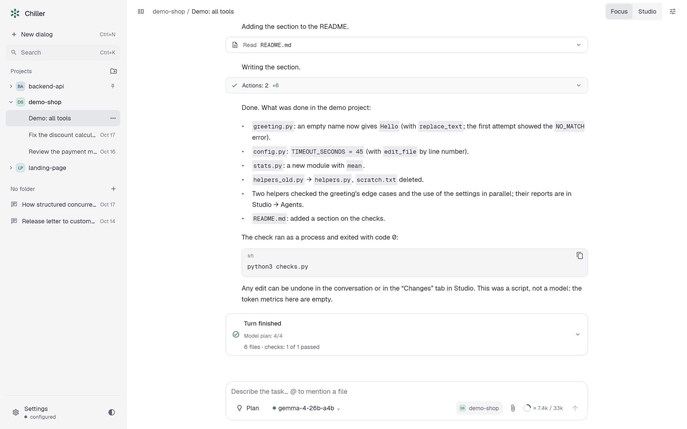
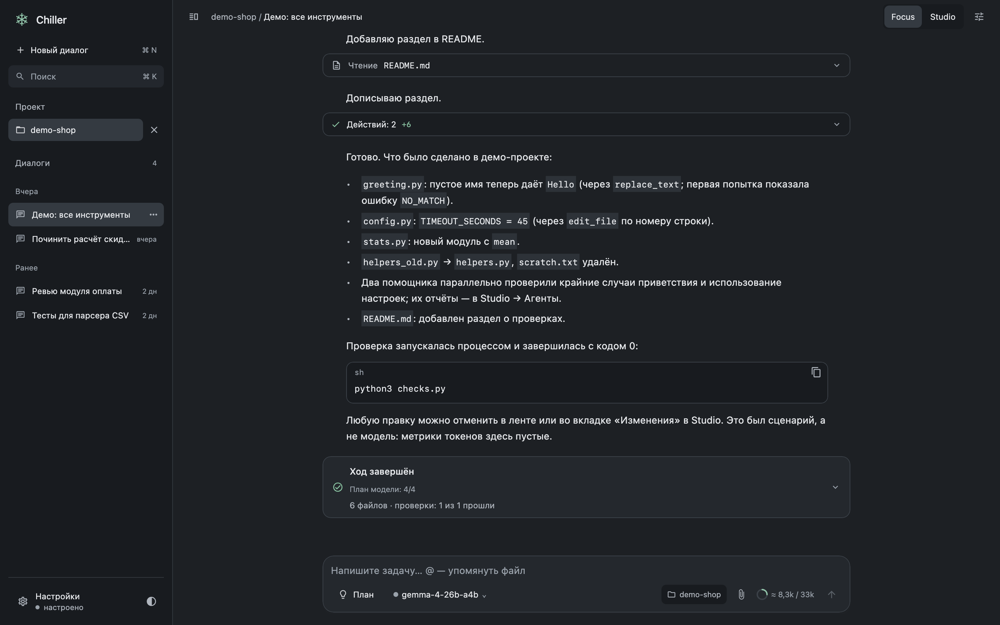
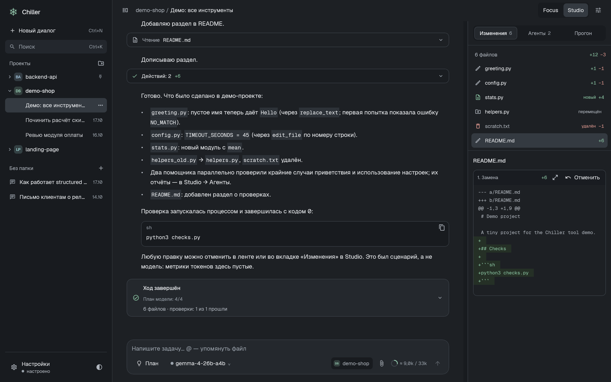
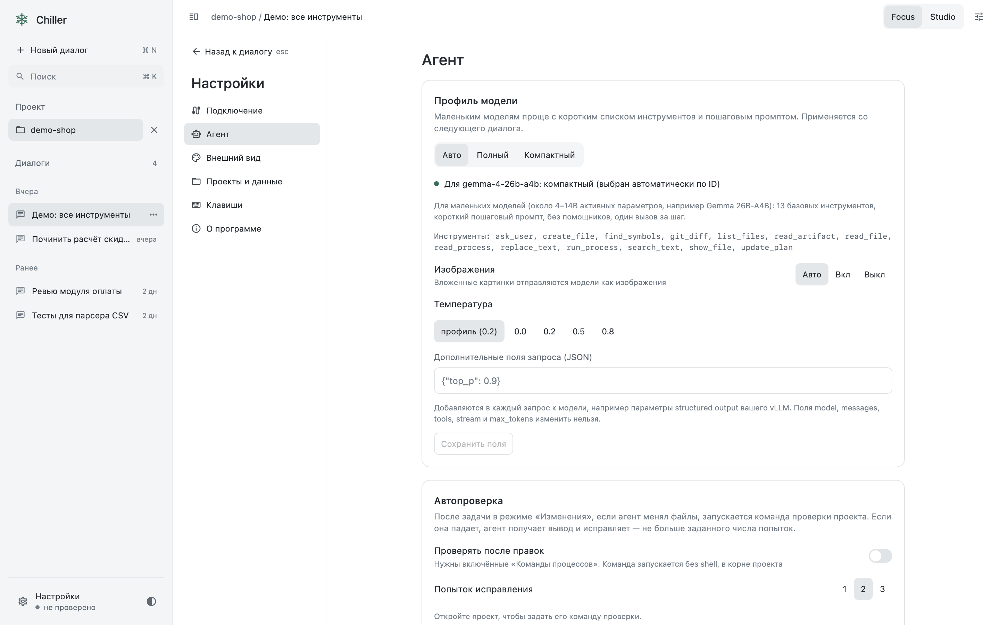

<div align="center">

# Chiller

**Desktop-агент для работы с кодом через локальные и облачные модели.**

Рабочий preview: возможности активно развиваются, изменения требуют проверки.

Kotlin · Compose Desktop · OpenAI-совместимые API · macOS и Windows

[Скачать релиз](https://github.com/Damirka1/Chiller/releases) · [Быстрый старт](#быстрый-старт) · [Почему Chiller](#почему-chiller) · [Подробности](docs/USAGE.md)



</div>

Chiller — настольное приложение, в котором модель работает с вашим проектом через точные инструменты: ищет, читает фрагменты, правит по снимкам файлов, запускает проверки и отчитывается. Главная цель — чтобы **модель на 4–30B параметров на вашем vLLM / Ollama / LM Studio** решала реальные задачи надёжно и быстро, а не только большие облачные модели.

## Почему Chiller

Chiller позволяет выбирать полный или компактный набор инструментов и ограничивать контекст. Цель — уменьшить число лишних чтений и упростить работу небольших моделей. Эффект зависит от модели и задачи.

### Быстрее: меньше раундов и токенов

| Что | Как это сделано | Эффект (живые замеры, DeepSeek V4.1 Flash) |
|---|---|---|
| **Компактный профиль** для небольших моделей | 13 базовых инструментов в текущей версии, короткий пошаговый промпт, один вызов за шаг, temperature 0.2 | В раннем профиле с 11 инструментами: 13/13 задач при **~146k** токенов промпта против **~235k** у полного профиля — **на 38% меньше** |
| **Карта проекта** в контексте с первого раунда | файлы по папкам и их объявления верхнего уровня, в пределах 3000 символов | 14/14 в обоих случаях; раундов **67 → 56 (−16%)**, вызовов инструментов 78 → 61, время 120 → 108 с; задачи «найди, где в коде…» — за 2 раунда вместо 4 |
| **Правки без перечитывания** | `edit_file` возвращает новый `snapshotId`, следующие правки того же файла идут без повторного `read_file` | меньше раундов на многошаговых правках |
| **Параллельное чтение** | независимые READ-вызовы выполняются одновременно, изменения — строго по порядку | несколько файлов за один раунд |
| **Стабильный префикс** | системная часть запроса не меняется между раундами | кэш провайдера: в замерах до 80% промпта приходит из кэша |
| **Чтение фрагментами** | `find_symbols` даёт строку определения, `read_file` читает диапазон, `search_text` — компактные `path:line` | в контекст попадает нужный кусок, а не файл целиком |

Замеры выше — отдельные небольшие прогоны на DeepSeek, а не статистическая гарантия и не проверка локальных моделей. Набор и версия профиля менялись между прогонами.

### Надёжнее: инструменты, в которых трудно ошибиться

- **Снимки вместо слепой записи.** Правка существующего файла ссылается на `snapshot_id` прочитанной версии. Если файл изменился, инструмент вернёт `STALE_SNAPSHOT`, а не перезапишет чужие изменения.
- **Никакого «примерного» применения.** `replace_text` требует точного совпадения и ожидаемого числа вхождений; частичные или невалидные аргументы не исполняются.
- **Структурированные ошибки с подсказкой.** Каждая ошибка содержит код и `recovery`-подсказку, а три одинаковые ошибки подряд останавливают цикл вместо бесконечного повтора.
- **Проверка до «готово».** При включённых автопроверке и разрешении процессов запускается настроенная команда проекта после правок и возвращает агенту вывод упавших тестов.
- **Итог хода из фактов, а не из слов модели.** Карточка в конце хода собирается из журнала: изменённые файлы, команды с кодами выхода, показанные файлы. Она отдельно подсвечивает упавшую и не перезапущенную проверку, непрочитанный результат, неприменившуюся правку и отсутствие подтверждённых команд проверки.
- **Отмена по ходу.** Изменения файловых инструментов можно откатить по ходу диалога, если текущее состояние допускает восстановление. Файлы, которые за ход изменили команды или вы сами, показываются отдельно: откат их не вернёт, обнаружение таких изменений ограничено размером снимка и проверяемых файлов.
- **Измеряемые потери.** Встроенные eval-задачи считают не только pass rate, но и повторные чтения, неудачные правки и объём вывода инструментов в контексте, чтобы улучшения были доказаны цифрами.

## Скриншоты

<table>
<tr>
<td width="50%"><br><sub><b>Focus</b> — диалог, сгруппированные вызовы инструментов, живой чек-лист плана под сообщениями.</sub></td>
<td width="50%"><br><sub><b>Studio</b> — инспектор: диффы, процессы, помощники, токены и раунды.</sub></td>
</tr>
<tr>
<td width="50%"><br><sub><b>Профиль модели</b> — авто по ID, набор инструментов, vision, temperature и поля запроса для vLLM.</sub></td>
<td width="50%"><br><sub><b>Светлая тема</b> — собственная дизайн-система, на общих компонентах Chiller.</sub></td>
</tr>
</table>

Скриншоты рендерятся из настоящего приложения и настоящего цикла агента на демо-проекте: `./gradlew :app-desktop:readmeShots`.

## Возможности

- **OpenAI-совместимые провайдеры**: готовые пресеты для vLLM, Ollama, LM Studio, DeepSeek, OpenAI, OpenRouter, Gemini, Groq, Mistral, xAI, Together, Fireworks. Ключ привязан к origin; на macOS его можно явно сохранить в Keychain. Совместимость каждого пресета отдельно не подтверждена.
- **Профили моделей**: «Полный» для больших моделей, «Компактный» для небольших, «Авто» выбирает по ID (например, `gemma-4-26b-a4b` → компактный), а для псевдонимов шлюза — по названию из каталога (`quasar` с названием «Gemma 4 26B A4B» → компактный).
- **Vision**: картинки из буфера и файлов уходят модели, которая их понимает, уменьшенными и только с последними сообщениями.
- **Фоновая подготовка вложений**: карточка показывает подготовку, кодирование идёт в фоне; текст больше 5 KiB превращается в файл-вложение. Задержка системного clipboard зависит от ОС и формата; [замеры](docs/PASTE_BENCHMARK.md) не включают время до первой отрисовки.
- **Помощники**: read-only субагенты для параллельных исследований с общим бюджетом запросов и токенов.
- **Режимы**: План (без записи и процессов), Изменения, отдельные разрешения на процессы, интернет и снимок окна.
- **Сравнение моделей** прямо в приложении: одни и те же задачи, pass rate, время, токены и потери рядом.
- **Журнал**: каждое действие пишется в append-only журнал, `run.summary` фиксирует раунды, вызовы, ошибки, время и usage провайдера. После сбоя побочные действия не повторяются автоматически.
- **Экспорт** в Markdown/JSON, история диалогов, переименование, редактирование и откат ходов.

## Быстрый старт

Готовые DMG и MSI — на странице [релизов](https://github.com/Damirka1/Chiller/releases); для них отдельный JDK не требуется. Ripgrep включён в установщик; отдельно устанавливать его не нужно.

Для запуска из исходников нужны JDK 21+ и Git; Gradle подготовит проверенный ripgrep для текущей платформы:

```bash
git clone https://github.com/Damirka1/Chiller.git
cd Chiller
./gradlew :app-desktop:run
```

1. Выберите папку проекта.
2. В «Настройки → Подключение» выберите пресет (например, vLLM `http://localhost:8000/v1`) и модель.
3. Пишите задачу. Для правок переключитесь в режим «Изменения», для тестов включите «Команды процессов».

Демо без модели и ключа: «Демо-сценарий» на стартовом экране показывает scripted-сценарий на настоящих файлах.

### Gemma на vLLM

Запустите vLLM с OpenAI-совместимым API и включённым tool calling: `--enable-auto-tool-choice` и `--tool-call-parser`, подходящий шаблону чата вашей модели (см. документацию vLLM). Укажите в Chiller адрес `http://<сервер>:8000/v1` и ID модели — профиль «Авто» включит компактный режим и vision. Окно контекста, vision и reasoning Chiller берёт из каталога `/models` (`max_model_len`, `input_modalities`, `capabilities`; поля — в [провайдерах](docs/PROVIDERS.md#vllm-и-шлюзы)). Переключатель «Рассуждения модели» для модели с `reasoning` в каталоге передаёт `chat_template_kwargs.enable_thinking`. Структурированный вывод vLLM можно передать через «Дополнительные поля запроса (JSON)».

Живая проверка 19 октября 2026: Gemma 4 26B A4B на vLLM 0.31 за HTTPS-шлюзом, по одному прогону на задачу.

| Профиль | Пройдено | Заметки |
|---|---|---|
| Компактный (выбран «Авто» по названию) | 12/13, `delegate-research` пропущена (нет помощников) | промахнулась `locate-code`: ответ по имени обёртки без чтения её тела |
| Полный | 13/14 | та же `locate-code` |
| Компактный + рассуждения | 3/3 на `fix-bug`, `count-todos`, `locate-code` | `locate-code` пройдена; токенов ответа в 2–15 раз больше |

`liveVisionSmoke` пройден (картинка с числом прочитана, ~1.3 с). Это небольшие прогоны, а не статистическая оценка.

## Оценка качества

```bash
./gradlew check :evals:offlineSmoke                       # без удалённой модели; нужны зависимости и Python 3
CHILLER_EVAL_PROFILE=compact ./gradlew :evals:liveEval     # платный прогон 14 задач; нужен настроенный ключ
CHILLER_EVAL_BASE_URL=http://localhost:8000/v1 CHILLER_EVAL_MODEL=gemma-4-26b-a4b-it ./gradlew :evals:liveEval
```

Каждая задача проверяется независимо (настоящие тесты Python/файлы), а проверки сами валидируются: падают на нетронутом проекте и проходят на эталонном решении. Отчёт `report.md` содержит pass rate, раунды, токены и потери по каждой задаче.

## Устройство

Десять модулей: `contracts` (замороженные контракты), `agent-core` (цикл агента, профили, контекст), `providers` (Chat Completions + SSE), `tools`, `workspace` (снимки, правки, откат), `runtime` (процессы), `sessions` (журнал), `evals`, `design-system`, `app-desktop`. Подробности — [архитектура](docs/ARCHITECTURE.md), [провайдеры](docs/PROVIDERS.md), [дизайн](docs/DESIGN.md), [разработка](CONTRIBUTING.md) и [использование](docs/USAGE.md).

CI на каждый push собирает и тестирует Linux, macOS и Windows и выпускает DMG и MSI; тег `vX.Y.Z` публикует релиз.

## Честно об ограничениях

- Проверки путей и cwd процессов — не OS-sandbox.
- Gemma/vLLM проверена вживую только на одном сервере (Gemma 4 26B A4B, vLLM 0.31 за шлюзом) и небольших прогонах; поиск символов лексический, не LSP.
- Установщики не подписаны: на macOS первый запуск — правый клик → «Открыть».
- Общий денежный потолок API пока не реализован; лимиты запросов и выходных токенов не гарантируют сумму расходов.
## Лицензия

Chiller распространяется под [Apache License 2.0](LICENSE). Лицензии сторонних компонентов сохраняются отдельно; см. [зависимости](docs/DEPENDENCIES.md).
