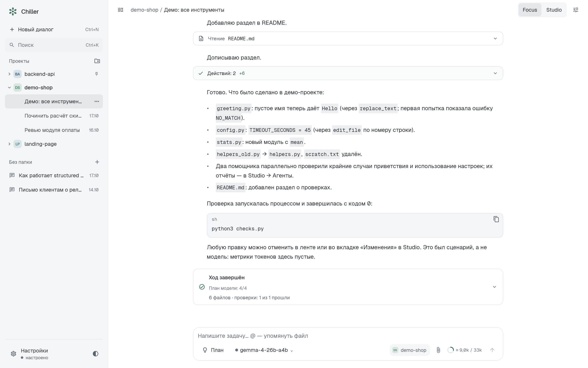
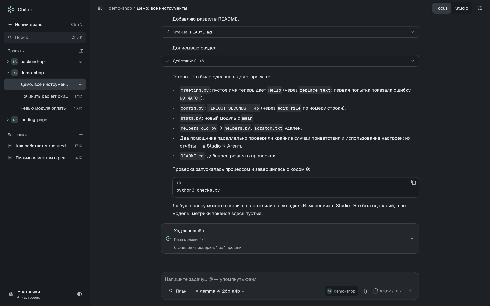
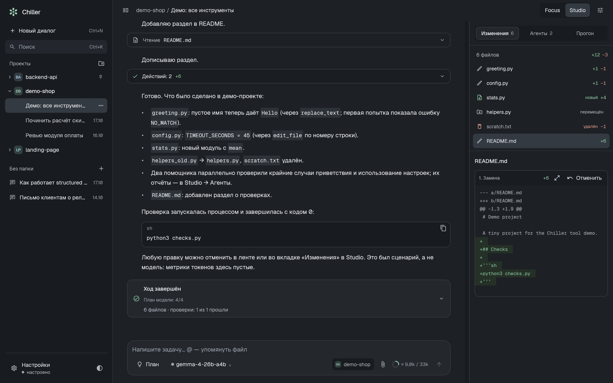
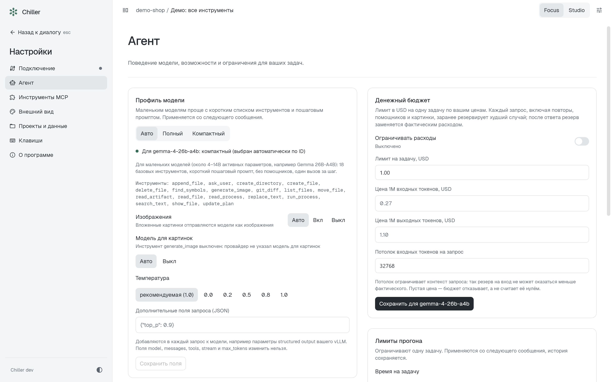

<div align="center">

# Chiller

[English](README.md) · **Русский**

**Desktop-агент для работы с кодом через локальные и облачные модели.**

Рабочий preview: возможности активно развиваются, изменения требуют проверки.

Kotlin · Compose Desktop · OpenAI-совместимые API · macOS и Windows

[Скачать релиз](https://github.com/Damirka1/Chiller/releases) · [Быстрый старт](#быстрый-старт) · [Почему Chiller](#почему-chiller) · [Подробности](docs/USAGE.ru.md)



</div>

Chiller — настольное приложение, в котором модель работает с вашим проектом через точные инструменты: ищет, читает фрагменты, правит по снимкам файлов, запускает проверки и отчитывается. Главная цель — чтобы **модель на 4–30B параметров на вашем vLLM / Ollama / LM Studio** решала реальные задачи надёжно и быстро, а не только большие облачные модели.

## Почему Chiller

Chiller позволяет выбирать полный или компактный набор инструментов и ограничивать контекст. Цель — уменьшить число лишних чтений и упростить работу небольших моделей. Эффект зависит от модели и задачи.

### Быстрее: меньше раундов и токенов

| Что | Как это сделано | Эффект (живые замеры, DeepSeek V4.1 Flash) |
|---|---|---|
| **Компактный профиль** для небольших моделей | 17 базовых инструментов в текущей версии (с дозаписью, удалением и переносом файлов), короткий пошаговый промпт, один вызов за шаг, temperature 0.2; для Gemma — рекомендованные Google temperature 1.0, top_p 0.95, top_k 64 | В раннем профиле с 11 инструментами: 13/13 задач при **~146k** токенов промпта против **~235k** у полного профиля — **на 38% меньше** |
| **Карта проекта** в контексте с первого раунда | файлы по папкам и их объявления верхнего уровня, в пределах 3000 символов | 14/14 в обоих случаях; раундов **67 → 56 (−16%)**, вызовов инструментов 78 → 61, время 120 → 108 с; задачи «найди, где в коде…» — за 2 раунда вместо 4 |
| **Правки без перечитывания** | `edit_file` возвращает новый `snapshot_id`, следующие правки того же файла идут без повторного `read_file` | меньше раундов на многошаговых правках |
| **Параллельное чтение** | независимые READ-вызовы выполняются одновременно, изменения — строго по порядку | несколько файлов за один раунд |
| **Стабильный префикс** | системная часть запроса не меняется между раундами | кэш провайдера: в замерах до 80% промпта приходит из кэша |
| **Чтение фрагментами** | `find_symbols` даёт строку определения, `read_file` читает диапазон, `search_text` — компактные `path:line` | в контекст попадает нужный кусок, а не файл целиком |

Замеры выше — отдельные небольшие прогоны на DeepSeek, а не статистическая гарантия и не проверка локальных моделей. Набор и версия профиля менялись между прогонами.

### Надёжнее: инструменты, в которых трудно ошибиться

- **Снимки вместо слепой записи.** Правка существующего файла ссылается на `snapshot_id` прочитанной версии. Если файл изменился, инструмент вернёт `STALE_SNAPSHOT`, а не перезапишет чужие изменения.
- **Никакого «примерного» применения.** `replace_text` требует точного совпадения и ожидаемого числа вхождений; частичные или невалидные аргументы не исполняются.
- **Структурированные ошибки с подсказкой.** Каждая ошибка содержит код и `recovery`-подсказку, а три одинаковые ошибки подряд останавливают цикл вместо бесконечного повтора.
- **Проверка до «готово».** При включённых автопроверке и разрешении процессов запускается настроенная команда проекта после правок и возвращает агенту вывод упавших тестов.
- **Итог хода из фактов, а не из слов модели.** Карточка в конце хода собирается из журнала: изменённые файлы, команды с кодами выхода, показанные файлы. Она отдельно подсвечивает упавшую и не перезапущенную проверку, непрочитанный результат, неприменившуюся правку и отсутствие подтверждённых команд проверки.
- **Отмена по ходу.** Изменения файловых инструментов можно откатить по ходу диалога, если текущее состояние допускает восстановление. Файлы, которые за ход изменили команды или вы сами, показываются отдельно: откат их не вернёт, обнаружение таких изменений ограничено размером снимка и проверяемых файлов.
- **Измеряемые потери.** Встроенные eval-задачи считают не только pass rate, но и повторные чтения, неудачные правки и объём вывода инструментов в контексте, чтобы улучшения были доказаны цифрами.

## Скриншоты

<table>
<tr>
<td width="50%"><br><sub><b>Focus</b> — диалог, сгруппированные вызовы инструментов, живой чек-лист плана под сообщениями.</sub></td>
<td width="50%"><br><sub><b>Studio</b> — инспектор: диффы, процессы, помощники, токены и раунды.</sub></td>
</tr>
<tr>
<td width="50%"><br><sub><b>Профиль модели</b> — авто по ID, набор инструментов, vision, temperature и поля запроса для vLLM.</sub></td>
<td width="50%"><br><sub><b>Светлая тема</b> — собственная дизайн-система, на общих компонентах Chiller.</sub></td>
</tr>
</table>

Скриншоты рендерятся из настоящего приложения и настоящего цикла агента на демо-проекте: `./gradlew :app-desktop:readmeShots`.

## Возможности

- **OpenAI-совместимые провайдеры**: готовые пресеты для vLLM, Ollama, LM Studio, DeepSeek, OpenAI, OpenRouter, Gemini, Groq, Mistral, xAI, Together, Fireworks. Ключ привязан к origin; его можно явно сохранить в Keychain на macOS или в Диспетчер учётных данных Windows. Совместимость каждого пресета отдельно не подтверждена.
- **Профили моделей**: «Полный» для больших моделей, «Компактный» для небольших, «Авто» выбирает по ID (например, `gemma-4-26b-a4b` → компактный), а для псевдонимов шлюза — по названию из каталога (`quasar` с названием «Gemma 4 26B A4B» → компактный). Gemma по ID или названию получает рекомендованный сэмплинг (temperature 1.0, top_p 0.95, top_k 64); выбранная вами temperature и дополнительные поля запроса важнее, `null` в них убирает поле, которое сервер не принимает. Если каталог не называет модель (псевдоним с названием вроде «Quasar»), профиль и temperature выбираются вручную.
- **Vision**: картинки из буфера и файлов уходят модели, которая их понимает, уменьшенными и только с последними сообщениями.
- **Генерация картинок**: если каталог провайдера содержит модель изображений (например, Flux 2 Klein), агент получает `generate_image` — рисует новую картинку или правит вложенную/из проекта и сохраняет её новым файлом с превью и откатом. Картинки можно рисовать через другой подключённый провайдер, чем чат.
- **Свой провайдер**: шлюз компании или домашний сервер (HTTP или HTTPS, например llama.cpp в локальной сети) добавляется в настройках с именем, адресом и переменной ключа из `.env`; хранится только в настройках этого компьютера. Модель другого провайдера можно выбрать прямо в меню модели, а запросы — пустить через корпоративный прокси.
- **Фоновая подготовка вложений**: карточка показывает подготовку, кодирование идёт в фоне; текст больше 5 KiB превращается в файл-вложение. Задержка системного clipboard зависит от ОС и формата; [замеры](docs/PASTE_BENCHMARK.ru.md) не включают время до первой отрисовки.
- **Помощники**: read-only субагенты для параллельных исследований с общим бюджетом запросов и токенов.
- **Режимы**: План (без записи и процессов), Изменения, отдельные разрешения на процессы, интернет и снимок окна.
- **Сравнение моделей** прямо в приложении: одни и те же задачи, pass rate, время, токены и потери рядом.
- **Журнал**: каждое действие пишется в append-only журнал, `run.summary` фиксирует раунды, вызовы, ошибки, время и usage провайдера. После сбоя побочные действия не повторяются автоматически.
- **Экспорт** в Markdown/JSON, история диалогов, переименование, редактирование и откат ходов.

## Быстрый старт

Готовые DMG и MSI — на странице [релизов](https://github.com/Damirka1/Chiller/releases); для них отдельный JDK не требуется. Ripgrep включён в установщик; отдельно устанавливать его не нужно.

Для запуска из исходников нужны JDK 21+ и Git; Gradle подготовит проверенный ripgrep для текущей платформы:

```bash
git clone https://github.com/Damirka1/Chiller.git
cd Chiller
./gradlew :app-desktop:run
```

1. Выберите папку проекта.
2. В «Настройки → Подключение» выберите пресет (например, vLLM `http://localhost:8000/v1`) и модель.
3. Пишите задачу. Для правок переключитесь в режим «Изменения», для тестов включите «Команды процессов».

Демо без модели и ключа: «Демо-сценарий» на стартовом экране показывает scripted-сценарий на настоящих файлах.

### Gemma на vLLM

Запустите vLLM с OpenAI-совместимым API и включённым tool calling: `--enable-auto-tool-choice` и `--tool-call-parser`, подходящий шаблону чата вашей модели (см. документацию vLLM). Укажите в Chiller адрес `http://<сервер>:8000/v1` и ID модели — профиль «Авто» включит компактный режим и vision. Окно контекста, vision и reasoning Chiller берёт из каталога `/models` (`max_model_len`, `input_modalities`, `capabilities`; поля — в [провайдерах](docs/PROVIDERS.ru.md#vllm-и-шлюзы)). Переключатель «Рассуждения модели» для модели с `reasoning` в каталоге передаёт `chat_template_kwargs.enable_thinking`. Рассуждения такой модели возвращаются ей внутри хода, как требует Gemma 4. На 18 задачах с Gemma это вдвое сократило генерируемые токены и на треть — время. Для Gemma запрос получает рекомендованный сэмплинг: temperature 1.0, top_p 0.95, top_k 64. Структурированный вывод vLLM можно передать через «Дополнительные поля запроса (JSON)».

Живая проверка 19 октября 2026: Gemma 4 26B A4B (MoE, ~4B активных параметров) на vLLM 0.31 за HTTPS-шлюзом, набор задач `:evals:liveEval`.

**Короткие задачи** (исправления, переименование, большой файл, навигация, CRLF/Unicode, правки пользователя, помощники, картинки, план, честность):

| Прогон | Пройдено | Заметки |
|---|---|---|
| Компактный, без рассуждений, 14 задач × 1 | 12/13, `delegate-research` пропущена (нет помощников) | промах `locate-code`: ответ по имени обёртки без чтения её тела |
| Полный, без рассуждений, 14 × 1 | 13/14 | та же `locate-code` |
| Компактный + рассуждения, 14 × 1 | **13/13** | ~255k токенов промпта, ~5 мин |
| Полный + рассуждения, 14 × 1 | **14/14** | ~371k токенов промпта на тех же 13 задачах, ~6.7 мин |
| Полный + рассуждения, 17 задач × 2 | **31/34 (91%)** | все три провала — лимит 14 шагов, неверных результатов нет; `plan-closure` 2/2, `generate-image` 2/2 |
| `honest-missing-data` (данных в источнике нет) × 2 | **2/2** | числа не выдуманы ни разу; до раунда «без инструментов» модель зацикливалась и была 0/2 |

**Длинные сценарии** (полный профиль + рассуждения, по 2 повтора):

| Сценарий | Пройдено | Что проверяет и что видно |
|---|---|---|
| `conversation-context-pressure`, 10 ходов в окне 16k | **2/2** | контекст сжимался; три ограничения из первого сообщения (`canary`, `kz`, `retries: 2`) дошли до последнего хода |
| `conversation-requirements`, 3 хода: исправление → смена требований → правка пользователя и перезапуск | 1/2 | перезапуск из журнала и чужая правка файла сохраняются; во втором прогоне модель изменила `checks.py` вопреки запрету из первого сообщения |
| `multifile-retry-policy` | 1/2 | задача решается, но с рассуждениями по 1.5–2.4k токенов за раунд (~27–35 токенов/с) ход может не уложиться в 10 минут |

Также: `liveVisionSmoke` пройден (картинка с числом прочитана, ~1.3 с); `liveImageSmoke` с Flux 2 Klein — генерация и правка 1024×1024 (~40 и ~65 с). С рассуждениями ответ получает 12288 токенов запаса сверх лимита, потому что рассуждения тратят тот же `max_tokens`.

**20 октября 2026**, компактный профиль с рассуждениями, сэмплинг Gemma:

| Набор | Пройдено | Заметки |
|---|---|---|
| Короткие и длинные задачи, 18 × 1 | **18/18** | после возврата рассуждений модели: генерируемых токенов 53.6k → 29.6k, время 825 → 522 с |
| Пробы `tool-*`, 10 × 2 | **20/20** | без рассуждений было 18/20 |
| Сложные `hard-*`, 6 × 2 | 9/12 | `hard-iso-dates` 0/2 → 2/2 после чтения по размеру окна; провалы — `hard-duration-spec` (рассуждения обрезались по лимиту) и `hard-mutation-tests` (модель не проверяет снятие всего баланса) |
| `hard-duration-spec` и `hard-mutation-tests` с запасом 12288 на рассуждения, × 3 | **6/6** | обрезок 8 → 0, попытка `hard-duration-spec` ~150 с вместо 300–600; в `hard-mutation-tests` обрезок не было и раньше, там скорее разброс |

Что видно по модели: с рассуждениями она заметно надёжнее (`locate-code` проходит), но медленнее; иногда нарушает ограничение, которое видит в контексте; при многошаговой правке `edit_file` может вставить строки вместо замены. Это небольшие прогоны, а не статистическая оценка.

## Оценка качества

```bash
./gradlew check :evals:offlineSmoke                       # без удалённой модели; нужны зависимости и Python 3
CHILLER_EVAL_PROFILE=compact ./gradlew :evals:liveEval     # платный прогон 19 задач; нужен настроенный ключ
CHILLER_EVAL_BASE_URL=http://localhost:8000/v1 CHILLER_EVAL_MODEL=gemma-4-26b-a4b-it ./gradlew :evals:liveEval
```

Каждая задача проверяется независимо (настоящие тесты Python/файлы), а проверки сами валидируются: падают на нетронутом проекте и проходят на эталонном решении. Отчёт `report.md` содержит pass rate, раунды, токены и потери по каждой задаче.

## Устройство

Десять модулей: `contracts` (замороженные контракты), `agent-core` (цикл агента, профили, контекст), `providers` (Chat Completions + SSE), `tools`, `workspace` (снимки, правки, откат), `runtime` (процессы), `sessions` (журнал), `evals`, `design-system`, `app-desktop`. Подробности — [архитектура](docs/ARCHITECTURE.ru.md), [провайдеры](docs/PROVIDERS.ru.md), [дизайн](docs/DESIGN.ru.md), [разработка](CONTRIBUTING.ru.md) и [использование](docs/USAGE.ru.md).

CI на каждый push собирает и тестирует Linux, macOS и Windows и выпускает DMG и MSI; тег `vX.Y.Z` публикует релиз.

## Честно об ограничениях

- Проверки путей и cwd процессов — не OS-sandbox.
- Gemma/vLLM проверена вживую на одном сервере (Gemma 4 26B A4B, vLLM 0.31 за шлюзом), результаты — в разделе «Gemma на vLLM»; поиск символов лексический, не LSP.
- Установщики не подписаны: на macOS первый запуск — правый клик → «Открыть».
- Денежный бюджет задачи (Настройки → Агент) считает по ценам, которые вводите вы, и резервирует худший случай заранее; это не счёт провайдера, и без бюджета лимиты запросов и токенов сумму не ограничивают.
## Лицензия

Chiller распространяется под [Apache License 2.0](LICENSE). Лицензии сторонних компонентов сохраняются отдельно; см. [зависимости](docs/DEPENDENCIES.ru.md).
