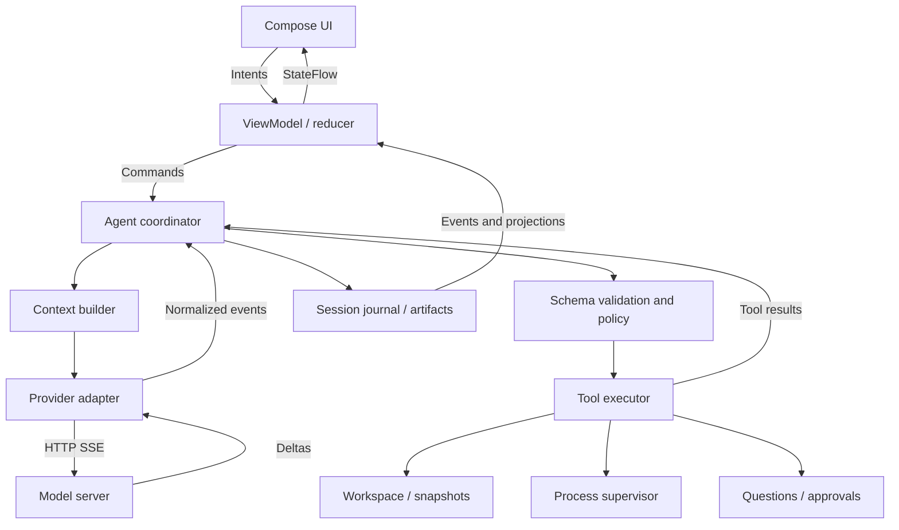

# Chiller — проект архитектуры и план разработки

Статус: основное направление и оба режима дизайна согласованы пользователем 16 октября 2026 года. Детали реализации уточнены в [MODULES](MODULES.md), [CONTRACTS](CONTRACTS.md), [BACKLOG](BACKLOG.md) и [AGENT_RUNBOOK](AGENT_RUNBOOK.md).
Git инициализирован, основная ветка — `master`. Реализация приложения ещё не начата. Первым доступным провайдером разработки выбран DeepSeek V4.1 Flash; live-проверка Gemma/vLLM отложена до доступа к серверу. [Профили провайдеров](PROVIDERS.md).

## 1. Продукт и границы

Chiller — красивое desktop-приложение для работы с кодом через локальные и удалённые модели. Основное преимущество: предсказуемые инструменты, экономный контекст, понятные изменения и восстановление после ошибок. Gemma 4 26B-A4B остаётся целевой моделью, но ядро не зависит от неё; первичная разработка и доступные live-проверки идут через DeepSeek V4.1 Flash.

Обещание «любая модель идеально программирует» недостижимо. Проверяемая цель: сократить ошибки использования инструментов и расход контекста, измерить успешность реальных задач на фиксированном наборе проектов.

Предлагаемые исходные решения:

- Kotlin/JVM + Compose Multiplatform Desktop. macOS — первая платформа для доводки интерфейса; Windows и Linux участвуют в ранних smoke-проверках и входят в beta.
- Один активный агент на рабочую папку в alpha; несколько чатов допустимы, записи сериализуются. Параллельные агенты, worktrees, MCP и полноценный IDE-редактор — после MVP.
- Без аккаунта Chiller и облачного backend. API-ключ провайдера, если нужен, остаётся необходимым.
- Провайдеры подключаются по проверяемым профилям возможностей. Надпись OpenAI-compatible сама по себе не гарантирует tools, vision или reasoning.
- Автоматические изменения в разрешённой папке с diff и локальными контрольными копиями; режим Plan запрещает побочные эффекты. Настройка Review before write доступна отдельно.
- Сначала подключаемся к уже работающему серверу модели. Установка и управление inference-сервером — отдельный будущий продуктовый этап.

## 2. Что исправить в исходном промпте

| Исходная идея | Предлагаемая корректировка |
|---|---|
| Строки надёжнее old_string | Только вместе с идентификатором прочитанной версии. Устаревшие строки могут попасть в чужой код. |
| Fuzzy matching как основа правок | Только поиск кандидатов для повторного чтения. Не применять приблизительное совпадение автоматически. |
| Любой OpenAI-compatible API | Адаптеры + диагностика возможностей + проверенная матрица server/model/template. |
| Reasoning через `<thought>` | Использовать поля и протокол конкретного провайдера. Не вырезать теги регуляркой из произвольного текста. |
| Логировать абсолютно всё | Разделить журнал выполнения, диагностические логи, экспорт и контекст модели; не писать ключи и заголовки авторизации. |
| Сложные инструменты и логи ближе к концу | Терминал, отмена, журнал и восстановление входят в первый сквозной сценарий. |
| Gemma на последней фазе | Компактные контракты учитывают Gemma с начала. Пока сервер недоступен, сначала DeepSeek и offline fixtures; после доступа — отдельная Gemma-проверка с возможностью уточнить внешнюю форму tools. |
| Material 3 или Jewel определяют внешний вид | Собственная система компонентов Chiller на Compose, с осознанным выбором вспомогательных библиотек. |

Точная замена уникального фрагмента сама по себе не плоха. Проблемы — неоднозначность, устаревшая версия и неявные нормализации. Сравним несколько способов редактирования на одних задачах, а не объявим победителя по вкусу.

## 3. Технологический выбор

| Область | Решение | Причина и ограничение |
|---|---|---|
| UI | Compose Desktop, Foundation, собственные ChillerTheme и компоненты | Контроль типографики, плотности, состояний и анимаций. Проверка accessibility обязательна. |
| Язык/runtime | Kotlin/JVM; JDK 21 как исходный кандидат | Зафиксировать совместимую стабильную связку Kotlin/Compose/Gradle/JDK после технической проверки. Не использовать nightly ради новизны. |
| Состояние | Coroutines, StateFlow; однонаправленный поток событий | UI не исполняет агентный цикл и не читает файловую систему. |
| Сеть | Ktor Client + SSE + kotlinx.serialization | Отдельные wire DTO и внутренние события. |
| Файлы | Java NIO, SHA-256, последовательный workspace writer | Побайтовая проверка версии; безопасное сохранение там, где это поддерживает FS. |
| Поиск | Поставляемый ripgrep с проверкой версии и лицензии | `--json`, лимиты, glob и ignore-файлы. Не строить shell-команды конкатенацией. |
| Процессы | ProcessBuilder для неинтерактивных задач | Отдельное чтение stdout/stderr; управление деревом процессов через платформенный адаптер. |
| PTY позже | Pty4J; JediTerm как кандидат для видимого терминала | PTY и эмулятор — разные вещи. Проверить Compose/Swing interop, DPI, IME, native-библиотеки и лицензии. |
| Сессии | JSONL + внешние blobs + восстанавливаемый индекс | Без базы данных в раннем MVP; SQLite можно добавить для поиска по большой истории. |
| Секреты | macOS Keychain / Windows Credential Manager / Linux Secret Service через адаптер | Если хранилище недоступно — ключ на время сессии. Не сохранять молча в plaintext. |
| Подсветка | Read-only viewer, ограниченный tokenizer в alpha | Tree-sitter/TextMate bindings оценить отдельным spike; подсветка вне UI thread, с кэшем по версии. |
| Иконки | Lucide, единая толщина и размер | Проверить лицензию выбранного набора и способ упаковки SVG. |
| Семантика кода | LSP4J в следующей версии | Потребуются реальные language servers, управление их жизненным циклом и синхронизация документов. |
| Упаковка | Compose native distributions / jpackage | Сборка и проверка на каждой целевой ОС, signing/notarization для macOS. |

Compose Desktop использует JVM и рисуемые компоненты, а не AppKit-контролы. Он позволяет сделать качественный интерфейс, но системные меню, VoiceOver, IME, оконные эффекты и диалоги проверяются отдельно. Если цель изменится на исключительно macOS и максимально нативное поведение, имеет смысл пересмотреть UI в пользу SwiftUI/AppKit до реализации.

Jewel реализует визуальный язык IntelliJ; его самостоятельное использование и совместимость с Compose требуют внимания. Для Chiller это необязательная зависимость, не фундамент. Источники: [Jewel](https://github.com/JetBrains/jewel), [release notes](https://github.com/JetBrains/intellij-community/blob/master/platform/jewel/RELEASE%20NOTES.md).

## 4. Архитектура



Модули первой версии:

```text
:app-desktop       composition root, UI, window lifecycle
:design-system     theme, typography, controls, motion
:contracts         domain types, ports, shared events
:agent-core        coordinator, context, policies
:providers         protocol adapters, streaming, capability probes
:workspace         snapshots, search, edits, checkpoints
:runtime           tool execution, processes, platform integrations
:tools             tool schemas, registry, typed wrappers
:sessions          journal, artifacts, export, recovery
:evals             replay fixtures, benchmark tasks, reports
```

Это модульный монолит. Не нужны микросервисы, универсальная plugin-платформа или DI-фреймворк ради нескольких зависимостей. Constructor injection достаточно. При необходимости переносим чистые типы в commonMain; desktop на трёх ОС сам по себе не требует множества Kotlin targets. Точное распределение ports, tools и runtime уточнено в MODULES.md; оно имеет приоритет над ранней укрупнённой схемой.

Agent coordinator — единственный владелец переходов состояния. На сессию — упорядоченная очередь событий. На workspace — очередь записей. Параллельно можно выполнять независимые чтения; запись, запуск изменяющих процессов и rollback конфликтуют и координируются.

### Машина состояний

```text
Idle → PreparingContext → StreamingModel
StreamingModel → ValidatingCalls → AwaitingApproval? → ExecutingTools
ExecutingTools → PreparingContext
ExecutingTools → AwaitingUserInput → PreparingContext
StreamingModel → Completed
любое активное состояние → Cancelling → Cancelled
ошибка → Failed или Interrupted → явное Resume / Retry
```

Thinking и текст ответа — каналы StreamingModel, а не обязательные последовательные состояния. Reasoning может отсутствовать. Background process имеет собственную машину состояний: Starting / Running / Exited / Failed / Stopping / Unknown.

Нельзя потерять ToolCompleted из-за заполненного SharedFlow. Критические события идут через упорядоченный writer с подтверждением записи. Текстовые дельты можно объединять для UI; они не должны создавать тысячи recomposition в секунду. UI никогда не является источником истины для выполненных операций.

### Агентный цикл

1. Принять запрос и записать TurnStarted; закрепить модель, профиль и разрешения этого turn.
2. Собрать контекст, оставив резерв на ответ и результаты инструментов.
3. Получать дельты; собирать tool calls по индексу и ID. Отображать текст и доступный reasoning.
4. До завершения вызова не исполнять частичный JSON. Оборванный stream не считается готовым действием.
5. Проверить схему, режим работы, пути, лимиты и необходимые разрешения.
6. Записать ToolPrepared. Исполнить разрешённые инструменты, зарегистрировать результаты.
7. Добавить assistant-сообщение с вызовами и отдельный tool-result на каждый call ID; продолжить цикл.
8. Завершить по финальному ответу, отмене, ошибке или исчерпанию бюджета. Результаты проверок показывать с фактическим статусом.

Начальные настраиваемые лимиты: 24 model rounds, не более двух исправлений одного невалидного вызова, лимит времени turn и повторения одинаковой ошибки. Это настройки для первых evals, не доказанные оптимальные значения.

## 5. Контракты инструментов

Инструменты имеют короткие описания, простые JSON-схемы и единый формат ошибок. Сложные oneOf и глубоко вложенные структуры не включать без проверки на целевой модели. Модель видит только разрешённый и поддержанный набор, а не весь будущий каталог.

Общие правила:

- Пути относительны корню workspace; абсолютные пути не нужны в обычных вызовах.
- Лимит строк/байтов/токенов устанавливается приложением. Модель может попросить меньше, но не снять лимит.
- Большой результат сохраняется как artifact. В контекст попадают summary, небольшой фрагмент и cursor.
- Результат явно сообщает `truncated`, `next_cursor`, статус и способ восстановления.
- Не интерпретировать инструкции из файлов, терминала и MCP-результатов как разрешения пользователя.
- Permission Engine проверяет реальные действия; инструкции в system prompt не заменяют этот слой.

### Каталог alpha/MVP

| Tool и вход | Выход | Поведение |
|---|---|---|
| `list_files(path, glob?, depth?, cursor?)` | Пути, типы, размеры, cursor | Ограниченное дерево/список. `.gitignore` и `.chillerignore`; исключённые каталоги не обходить без явного режима. |
| `search_text(query, path?, glob?, regex?, cursor?)` | Совпадения с путём, строкой, небольшим контекстом | По умолчанию literal. Stable ordering. Snapshot поиска; устаревший cursor возвращает ошибку. Перед правкой нужно чтение. |
| `read_file(path, start_line?, end_line?)` | Snapshot ID, число строк, пронумерованный фрагмент, EOL/encoding | Стабильный snapshot полных исходных байтов, хотя в модель передаётся диапазон. Лимит размера, защита от бинарных файлов. |
| `edit_file(path, snapshot_id, edits[])` | Before/after revisions, diff artifact, сводка | Операции replace/insert/delete над прочитанной версией. All-or-nothing для одного файла при поддерживаемом atomic replace. |
| `create_file(path, content)` | Revision, diff | Только создание. Существующий файл → ALREADY_EXISTS. Перезапись не маскируется под создание. |
| `move_file(path, snapshot_id, destination)` | Старый/новый путь, change ID | Без перезаписи назначения. В MVP только обычный файл внутри workspace. |
| `delete_file(path, snapshot_id)` | Change ID, recovery reference | Только обычный файл, с восстановимой копией. Рекурсивного удаления каталога этим tool нет. |
| `run_process(argv, cwd?, timeout_ms?, background?)` | Process ID, стартовый вывод/exit code | По умолчанию executable + массив аргументов; запуск оболочки — явный вариант политики. |
| `read_process(process_id, cursor?)` | Новые stdout/stderr, cursor, exit status | Повторное чтение не теряет output; ограниченное ожидание. |
| `stop_process(process_id)` | Stopping / Exited / error | Остановка дерева/группы по возможностям платформы; повторный вызов безопасен. |
| `read_artifact(artifact_id, cursor?, limit?)` | Страница большого результата | Только артефакты доступной сессии, не произвольный путь на машине. |
| `ask_user(question, options?)` | Выбранное или свободный текст | Приостанавливает именно run. Закрытие окна не трактуется как согласие. |

В режиме Plan остаются чтения и вопросы; `run_process` выключен по умолчанию, поскольку даже тесты и сборки могут менять файлы. Проверенный preview diff вычисляет приложение, а не записывающий инструмент.

### Beta и последующие версии

| Tool / возможность | Этап | Условия |
|---|---|---|
| `read_image(path)` | Beta | Настоящий multimodal input через adapter; метаданные и отсутствие vision отображаются явно. |
| `capture_screenshot(target)` | Beta | Пользователь выбирает окно/экран; системные разрешения; изображение только выбранному провайдеру. |
| `git_status`, `git_diff`, `git_log` | Beta | Read-only. Собственные изменения отделены от ранее существовавших. |
| `apply_patch(patch, expected_revisions)` | После evals | Только exact hunks + версии; не давать одновременно несколько конкурирующих способов редактирования слабой модели без пользы в evals. |
| `get_symbols`, `find_references`, `get_diagnostics` | v1 | LSP/индекс; отдавать version и freshness. |
| `rename_symbol` | v1 | LSP WorkspaceEdit через общий механизм проверки и предварительный diff. |
| `fetch_url`, browser tools | v1 | Отдельный сетевой профиль разрешений, лимиты и недоверенный контент. |
| MCP | v1 | Внешние инструменты проходят те же лимиты, журнал, policy и обработку отмены. |
| Multi-agent / worktrees | Позже | Изоляция рабочих копий, merge/conflicts, общий бюджет. Не нужен для доказательства основного преимущества. |

`undo_change` и выбор контекста сначала реализуются как команды UI, чтобы модель не отменяла пользовательскую работу без необходимости. `update_plan` можно добавить после оценки пользы; план сессии изначально доступен пользователю в UI.

### Единый результат

```json
{
  "ok": false,
  "call_id": "call_17",
  "error": {
    "code": "STALE_SNAPSHOT",
    "message": "File changed after it was read; no edit was applied.",
    "retryable": true,
    "recovery": {"tool": "read_file", "path": "src/App.kt", "start_line": 35, "end_line": 70}
  },
  "meta": {"truncated": false, "duration_ms": 3}
}
```

Основные ошибки: INVALID_ARGUMENTS, PATH_OUTSIDE_WORKSPACE, PERMISSION_DENIED, NOT_FOUND, ALREADY_EXISTS, BINARY_FILE, UNSUPPORTED_ENCODING, FILE_TOO_LARGE, STALE_SNAPSHOT, OVERLAPPING_EDITS, TIMEOUT, CANCELLED, OUTPUT_LIMIT, PROVIDER_UNSUPPORTED. Для каждой есть машинно читаемое действие восстановления или явный запрет повторения.

### Kotlin-контракт, схема проектирования

```kotlin
interface Tool<A : Any, R : Any> {
    val name: String
    val description: String
    val inputSerializer: KSerializer<A>
    val outputSerializer: KSerializer<R>
    val inputSchema: JsonObject
    val effect: ToolEffect // Read, FileWrite, Process, UserInteraction
    suspend fun execute(args: A, context: ToolContext): ToolOutcome<R>
}
```

ToolRegistry хранит typed wrappers; wrapper валидирует JSON Schema, затем декодирует Kotlin DTO и выполняет domain validation. Policy и журнал находятся вокруг execute, а не в UI. `kotlinx.serialization` не считается готовым генератором JSON Schema: первоначально схемы задаются явно и проверяются contract fixtures. UI и capabilities строятся по тем же registry entries, чтобы описание и выполнение не расходились.

## 6. Надёжное редактирование

### Внешний протокол

```text
read_file("src/App.kt", 40, 65)
→ snapshot_id: r42, total_lines: 117
  40 | fun greeting(name: String) {
  41 |     println(name)
  42 | }
```

```json
{
  "path": "src/App.kt",
  "snapshot_id": "r42",
  "edits": [
    {"op": "replace", "start_line": 41, "end_line": 41, "content": "    println(\"Hello, $name\")"}
  ]
}
```

`r42` — короткий opaque ID, который выдаёт приложение; он привязан к workspace, пути и хешу байтов. Модель не вычисляет хеш. При утрате snapshot после compaction/restart требуется повторное чтение.

### Точные правила диапазонов

- Нумерация с 1. replace/delete: обе границы включительные и должны существовать.
- insert: `before_line` от 1 до N+1; N+1 означает конец. Для пустого файла N=0 и допустим insert before_line=1.
- Все операции относятся к одному исходному snapshot. Перекрытия и двусмысленные вставки в одну позицию отклоняются.
- Каждая изменяемая строка должна быть показана модели через действующий read; вставка допускается у видимой границы.
- `content` содержит текст, без префиксов нумерации. Внутри используется LF; приложение кодирует вставку в согласованный EOL файла. Неизменённые диапазоны копируются побайтово.
- Последний newline, BOM и encoding сохраняются по умолчанию. Изменение EOF newline — отдельный явный параметр; смешанные EOL не нормализуются молча, при неоднозначной границе возвращается ошибка.
- Первая версия: UTF-8 с/без BOM; другие кодировки читаются/изменяются только при явной поддержке. Не декодировать с silent replacement characters.

### Псевдокод исполнителя

```text
validateSchemaAndDomain(args)
resolveAllowedWorkspacePath(args.path)
with workspaceWriterLock:
    original = readRegularFileNoSymlinkEscape(path)
    snapshot = snapshotStore.requireBound(args.snapshotId, workspace, path)
    if sha256(original.bytes) != snapshot.sha256: return STALE_SNAPSHOT
    validateObservedRanges(snapshot, edits)
    validateRangesAndNoOverlap(edits)
    nextBytes = applyToOriginalBytes(original, edits)
    preview = diff(original, nextBytes)
    policy.requireWritePermission(path, preview)
    durableStoreBeforeImage(original)
    journal.prepare(changeId, beforeHash, afterHash, previewRef)
    temp = writeSiblingTemp(nextBytes, preserveSupportedMetadata=true)
    fsync(temp)
    recheckFileIdentityPathAndHash(path, original)
    atomicReplaceWhereSupported(temp, path)
    fsyncParentWhereSupported(path)
    journal.commit(changeId, afterHash)
    return newSnapshotAndDiff()
```

На не поддерживающей atomic replace файловой системе операция не должна молча получать те же гарантии: либо явно ограниченный режим, либо отказ. Сохранение прав, owner/ACL/xattrs и поведение hard links проверяются отдельно; неизвестные специальные файлы не редактируются.

Lock координирует Chiller, но не произвольные внешние редакторы. Повторная проверка перед rename существенно сокращает риск, однако переносимый Java NIO не даёт универсального compare-and-swap против враждебного внешнего writer. Это не обещание абсолютной изоляции. Для строгих гарантий потребуется управляемая рабочая копия или платформенный файловый broker. Watcher сообщает о внешних изменениях, но не заменяет проверку байтов.

При падении между prepare и commit восстановление сверяет фактический хеш: before → не применено; after → можно завершить запись события; другой → конфликт, ничего автоматически не перезаписывать. Undo применим только если текущий файл совпадает с ожидаемой after-версией; иначе показать конфликт. Несколько файлов не являются одной атомарной файловой транзакцией: журнал хранит прогресс и безопасное восстановление каждого.

### Проверка выбора способа редактирования

Сравнить на одном наборе задач: уникальная exact replacement + версия; строки + версия; opaque anchors + версия. Метрики: валидность вызовов, правильность места правки, число повторных чтений, токены, успешность тестов. Никакой автоматической fuzzy-правки. Общий snapshot/checkpoint слой остаётся одинаковым при смене внешнего tool API.

## 7. Терминал и разрешения

- ProcessBuilder стартует на IO dispatcher; stdout и stderr читаются двумя coroutine одновременно, чтобы заполненный pipe не заблокировал процесс.
- Supervisor хранит process ID, команду, cwd, время, разрешения, exit code и монотонный cursor вывода. Никакого неограниченного массива строк в памяти.
- Полный вывод пишется с лимитами на диск; модель получает короткий tail и artifact reference. При достижении hard cap явно применять выбранную политику: stop или discard дальнейших байтов с отметкой, а не незаметное зависание.
- stdin закрыт по умолчанию. Если требуется интерактивная программа — PTY и отдельное пользовательское действие. Агент не должен зависать на password prompt.
- Отмена модели и отмена процесса — отдельные операции. Stop run прекращает сеть и foreground-процессы этого run; background services отображаются отдельно и имеют явную кнопку Stop.
- Мягкое завершение → grace period → принудительное. Unix process groups и Windows Job Objects исследуются для дерева потомков; ProcessHandle.descendants сам по себе не считается полноценной изоляцией.
- После перезапуска приложения не переподключаться к произвольному PID без проверки идентичности; безопасный fallback — Unknown и понятное сообщение пользователю.
- Ошибка сети после shell side effect не разрешает повторный запуск команды. Сначала сверить журнал; неизвестный исход требует проверки состояния или решения пользователя.

Режимы: Plan; Workspace edit; расширенный доступ по явной настройке. Внутри workspace обычные чтения и обратимые правки не должны требовать клика на каждом шаге. Разрешения запоминаются в пределах заданного scope. Shell и выход за папку контролируются отдельно.

Проверка cwd и regex команд не является OS sandbox. Alpha допустима как инструмент для доверенных локальных проектов с явно разрешённым терминалом. Для beta отдельно реализуется и тестируется ограничение процессов по ОС или предлагается контейнер/изолированное окружение. До этого нельзя обещать, что shell физически ограничен папкой проекта.

## 8. Провайдеры, SSE и Gemma

### Внутренний интерфейс

```kotlin
interface LlmProvider {
    suspend fun probe(): ProviderCapabilities
    fun stream(request: AgentRequest): Flow<ModelEvent>
}
```

Capabilities: toolCalling, streamedTools, parallelTools, vision, reasoningChannel, structuredOutput, usageReporting, contextLimit, cancellationBehavior. Возможность имеет status verified/unsupported/unknown, источник проверки, дату и fingerprint server/model/profile. Смена модели сбрасывает подтверждённые предположения.

Wire DTO Chat Completions включают `model`, `messages`, `stream`, `tools`, опциональные `tool_choice`, `parallel_tool_calls`, ограничения output и расширения профиля. Не посылать все опции каждому серверу. `content` — строка, null или список multimodal parts в зависимости от роли и провайдера. Tool-result содержит `tool_call_id`. Tools задаются как function name/description/parameters.

Для чанков нужны: response ID, choices[index], delta.content, delta.tool_calls[index/id/type/function.name/function.arguments], finish_reason и usage. Reasoning поля нормализуются адаптером (`reasoning`, `reasoning_content` и др.); wire-совместимость не должна протекать в UI.

SSE parser поддерживает разбиение UTF-8 и JSON между сетевыми пакетами, несколько data-строк события, keepalive comments, пустые choices, финальный usage, `[DONE]`, HTTP error body вместо stream, abrupt EOF и отмену. Tool arguments накапливаются по call index; ID может прийти отдельно. Unfinished или malformed call никогда не исполняется.

Timeouts: connect, time-to-first-token, idle gap и общий бюджет — разные значения. Не применять короткий общий request timeout к длинной генерации. Automatic SSE reconnect по умолчанию выключен для генерации: повторный POST может создать новый ответ. До появления side effects допустим ограниченный retry по правилам провайдера; после них — восстановление через журнал.

Ktor предоставляет SSE-клиент и механизм reconnect; решение отключить неявное возобновление генерации — правило Chiller. [Документация Ktor](https://ktor.io/docs/client-server-sent-events.html).

### Профиль Gemma 4

Google документирует function calling у Gemma 4, включая `google/gemma-4-26B-A4B-it`. В официальном vLLM recipe есть Gemma-specific tool/reasoning parsers. Проверяем точную установленную версию vLLM и её параметры запуска; не предполагаем, что имя парсера и template неизменны между релизами. [Google function calling](https://ai.google.dev/gemma/docs/capabilities/text/function-calling-gemma4), [vLLM recipe](https://docs.vllm.ai/projects/recipes/en/stable/Google/Gemma4.html).

Reasoning не обязан быть `<thought>`. Для Gemma опубликована структура каналов; исторические thoughts имеют особые правила повторной передачи, включая исключение для tool-call turns. Это задача адаптера: UI-журнал и messages следующего запроса — разные представления. [Gemma model card](https://ai.google.dev/gemma/docs/core/model_card_4).

Модель не считать «4B по памяти» из-за A4B: число активных параметров и размер всех весов — разные величины. Рабочий context limit выбирается по серверу, квантованию и железу, а не только по максимальному окну из model card.

Первые smoke tests: текст → один tool → два последовательных tool → malformed arguments → большой результат → отмена → image при заявленной vision. Зафиксировать квантование, template, sampling и версии. Базовые sampling-настройки взять из официального профиля и затем измерять; не устанавливать temperature=0 всем reasoning-моделям автоматически.

### Совместимость

| Профиль | Проверяем |
|---|---|
| DeepSeek V4.1 Flash | Первый доступный live-профиль; отдельные правила thinking replay, model ID `deepseek-flash` |
| vLLM + целевая Gemma | Native tool calls, reasoning, streaming, template, context и cancellation |
| Ollama + выбранная модель | Реально поддерживаемая часть OpenAI API, модельные tools/vision, размер контекста |
| OpenRouter + выбранный endpoint | Преобразования провайдера, tools, usage, reasoning, ошибки маршрутизации |
| OpenAI-compatible generic | Только минимальный проверенный контракт; неподдержанные функции отключены |

Прямой OpenAI Responses API при необходимости оформляется отдельным адаптером. Нельзя смешивать его события с Chat Completions DTO. [Ollama compatibility](https://docs.ollama.com/api/openai-compatibility).

## 9. Контекст: главный рычаг качества

1. Старт: задача пользователя, явные правила проекта, краткая карта файлов, открытые пользователем фрагменты.
2. Поиск: glob → text search → небольшой read. Не отправлять весь репозиторий.
3. Правка: актуальный snapshot и соседний контекст, без повторной пересылки тысяч неизменённых строк.
4. Проверка: диагностическая сводка + ссылки на полный лог. Не объявлять «тесты прошли», если команда не запускалась или завершилась неизвестно.
5. Compaction: сохранять цель, решения, список изменений, выполненные проверки, unresolved issues и pending tool-call pairs. Сводку отмечать как производную и потенциально неполную.

Схемы tools, системный prompt, картинки и tool results входят в общий бюджет. Если точный tokenizer недоступен, использовать консервативную оценку с запасом и показывать «оценка». Резервировать output перед запросом. Дедуплицировать повторное чтение одного revision, но не возвращать устаревший результат как свежий.

После compaction или изменений файлов snapshot handles переоцениваются; при сомнении новое чтение. Семантический vector index и RAG не обязательны для MVP: сначала измерить пользу простого поиска и структурного outline.

## 10. Журнал, данные и восстановление

```text
~/.chiller/
  config.json                 # без API-ключей
  sessions/<id>/events.jsonl
  sessions/<id>/index.json     # производный, можно перестроить
  sessions/<id>/blobs/<hash>
  sessions/<id>/snapshots/
```

Пути платформы можно адаптировать к системным data directories; выбор фиксируется перед alpha. Workspace-specific настройки — `.chiller/config.json`, без ключей. Проектный конфиг не может расширить глобальные разрешения без решения пользователя.

Минимальная JSON Schema envelope (payload валидируется отдельной схемой по type):

```json
{
  "$schema": "https://json-schema.org/draft/2020-12/schema",
  "type": "object",
  "required": ["schema_version", "event_id", "session_id", "seq", "timestamp", "type", "payload"],
  "properties": {
    "schema_version": {"type": "integer", "const": 1},
    "event_id": {"type": "string"},
    "session_id": {"type": "string"},
    "turn_id": {"type": ["string", "null"]},
    "call_id": {"type": ["string", "null"]},
    "seq": {"type": "integer", "minimum": 0},
    "timestamp": {"type": "string", "format": "date-time"},
    "type": {"enum": ["session.started", "turn.started", "model.delta", "model.completed", "tool.prepared", "tool.completed", "tool.failed", "approval.requested", "approval.resolved", "question.requested", "question.answered", "change.prepared", "change.committed", "context.compacted", "turn.completed", "turn.interrupted"]},
    "payload": {"type": "object"}
  },
  "additionalProperties": false
}
```

В payload фиксируются профиль модели, аргументы tools, outcome, usage (если доступен), before/after hash, ссылки на diff и большие результаты. Timestamp — UTC, отображение по timezone пользователя. Порядок определяется seq, а не часами.

Single writer, versioned migrations, восстановление после обрезанной последней JSONL-строки. Повреждение внутри файла не пропускать молча. Большие бинарные данные не base64-ить в каждую строку. Перед write checkpoint и prepare должны быть durable; commit подтверждает фактический исход. Дельты можно писать пакетами, критические границы — отдельно.

Отделить три потока: приватные данные сессии; технические диагностические логи с redaction; экспорт с preview и удалением чувствительных полей. API-ключи и auth headers не сохранять ни в одном из них. Код и ответы tools могут содержать секреты, поэтому сессия — приватные данные, а не «безопасный лог». Reasoning сохраняется только если провайдер его возвращает и пользователь включил сохранение; полноту скрытых мыслей не обещать.

Экспорт Markdown — удобная история с diff и результатами. JSON export — версионированный переносимый bundle или JSON + явно перечисленные blobs. Добавить retention, размер хранилища, удаление сессии и очистку недостижимых blobs. Cloud sync отсутствует в MVP.

## 11. Визуальная концепция

Направление: спокойный профессиональный инструмент. Выразительность через композицию, типографику и качество взаимодействий, с одним сдержанным акцентом. Без обязательного стекла, декоративных градиентов и постоянного движения.

Два варианта для обсуждения:

- **Focus** — компактная левая панель, широкий диалог, изменения раскрываются внутри работы. Предлагаемый вариант по умолчанию.
- **Studio** — диалог и панель diff рядом; удобен для длительного review. Та же дизайн-система, иной рабочий режим.

Слева: workspace, новый чат, история с группировкой по времени; настройки провайдера в отдельном экране. Сверху: название задачи и открытие inspector. Центр: сообщения и компактная timeline операций. Справа по запросу: Changes / Files / Context. Внизу: composer, вложения, модель, режим, Stop.

Дифф содержит before/after, отличимые добавления и удаления, путь, исходные номера строк, статус Applied/Proposed/Conflict. Нельзя показывать кнопку Apply, если изменения уже записаны. Для Applied доступны открыть и Undo с проверкой версии. Откат — без `git reset --hard`.

Reasoning по умолчанию свёрнут. Основной статус — фактическое действие «Читает App.kt», «Запускает тесты», «Ждёт ответ». Если провайдер не отдаёт reasoning, показывать только status, а не синтезированные «мысли».

Начальные дизайн-токены: spacing 4/8/12/16/24/32; основной текст 14–15, код 12–13 с масштабированием, заголовок 20–24; мягкие radii 8–16, ровные borders, минимальная тень. Светлая и тёмная тема проектируются одновременно. На macOS — системная типографика, на других ОС — системный эквивалент; SF Pro не поставляется как универсальный сторонний шрифт.

Motion — предложенные значения Chiller, не стандарты Apple:

| Взаимодействие | Поведение |
|---|---|
| Hover/focus/press | 100–140 мс, локальная смена поверхности; press слегка меняет масштаб |
| Раскрытие карточки | 160–220 мс, height/opacity без скачка scroll |
| Inspector | 200–260 мс, изменение ширины и положения |
| Отправка сообщения | 160–200 мс, короткий сдвиг и появление |
| Поток текста | Обновления пакетами, без отдельной анимации каждого токена |
| Reduce Motion | Убрать перемещения/пружины; сохранить ясную смену статуса |

Никакой бесконечной декоративной анимации. Новый текст не тянет пользователя вниз, если он читает старую часть. В этом случае появляется «К последнему сообщению». Длинная история и diff виртуализируются. Состояния empty/loading/offline/error/conflict/permission/partial result — часть дизайна с первого этапа.

Доступность: keyboard-first, видимый focus, screen reader labels, zoom, контраст, IME, drag-and-drop, native file picker; статус различается текстом и формой, а не только цветом. Desktop не превращается в увеличенный мобильный интерфейс.

## 12. План разработки и критерии завершения

Оценка для одного опытного разработчика при регулярной работе. Это диапазоны усилий, не обещание календарной даты. Аппаратные ограничения и качество сторонних серверов могут изменить сроки.

| Этап | Усилия | Результат | Критерий выхода |
|---|---|---|---|
| 0. Решения и проверка рисков | 3–5 рабочих дней | UI spike, model probe, ADR, базовый eval corpus | Оба режима согласованы; FakeProvider и доступный DeepSeek проверяют streaming/tools, live требует ключа и бюджета; проверены ограничения раннего Compose/runtime стека |
| 1. Вертикальный срез | 5–7 дней | Чат → модель → чтение → правка → тест → diff; журнал с первого дня | Приложение завершает несколько реальных маленьких задач; Stop работает; перезапуск восстанавливает историю |
| 2. Файловое ядро | 5–8 дней | Snapshot editing, поиск, checkpoints, undo, file operations | Ошибочные и устаревшие правки не пишут файл; обязательные filesystem fixtures проходят |
| 3. Agent runtime и провайдеры | 5–8 дней | SSE edge cases, budgets, questions, policy, profiles | Malformed/partial calls не исполняются; tool results не теряются; циклы ограничены; DeepSeek проверен при доступе, Gemma live отмечена pending до сервера |
| 4. Desktop alpha | 5–8 дней | Полный UI, темы, motion, Changes/Context, export, настройки | Повседневный сценарий работает с клавиатуры; длинная сессия не блокирует UI; дизайн проходит review |
| 5. Beta и платформы | 7–12 дней | Images/screenshots, native integrations, installers, hardening | Матрица ОС; разрешения/пути/отмена; корректные отказы; проверены установщики и экспорт |
| 6. Release candidate | 3–5 дней | Regression evals, исправления, документация, package signing | Пройдены release gates; задокументированы ограничения; воспроизводимая сборка |

Суммарно 33–53 рабочих дня, ориентир 7–11 недель без длительных внешних ожиданий. Сквозной прототип — примерно в первые две недели; alpha появляется раньше полного цикла. Красивый UI начинается на этапе 0 и развивается во всех этапах, а не добавляется в самом конце.

Зависимости: 0 → 1 → 2 → 3 → 4 → 5 → 6. Уточнение дизайна и eval corpus идут через весь путь. Ранние smoke-проверки Windows/Linux начинаются с этапа 1, чтобы не обнаружить фундаментальные проблемы только на beta.

### Backlog следующей версии

LSP navigation/diagnostics → безопасные semantic edits → MCP → Git/worktrees → несколько агентов → управление локальными inference-профилями. Авторизация Chiller добавляется только при появлении реальной облачной функции; заранее достаточно отделить provider credentials от domain state.

## 13. Проверки качества

### Обязательные детерминированные проверки

- Файлы: LF/CRLF, UTF-8/BOM, пустой файл, EOF newline, смешанные EOL, tabs, кириллица/emoji, одинаковые блоки, большие файлы, бинарный input, пересекающиеся правки, внешние изменения.
- Пути: `..`, абсолютные пути, symlink escape, hard links, регистр на разных FS, имена с пробелами, недоступные права, Windows path forms.
- Recovery: падение до/после prepare, rename и commit; прерванный JSONL; rollback после пользовательской правки; disk full.
- SSE: разрыв JSON и Unicode на чанках, частичные arguments, несколько calls, пустой choices, timeout, unexpected EOF, cancellation.
- Процессы: большой stdout+stderr одновременно, child/grandchild, не закрытые pipes, interactive wait, timeout, app close, detached process.
- UI: keyboard navigation, zoom/HiDPI, IME, обе темы, reduced motion, длинные диалоги, scroll anchoring и большие diff.

### Agent evals

Начать с 30–50 задач на небольших реальных fixture-репозиториях: исправление функции; точная правка в повторяющемся коде; изменение нескольких файлов; неизвестная структура; падающий тест; stale snapshot; malformed call; отмена; ограниченный context; внешнее изменение.

Сравнивать одинаковую модель, сервер, квантование, sampling, budgets и исходный commit. Выполнять несколько повторов; отдельно показывать инфраструктурный сбой, неправильное использование tool и неправильное решение задачи. Отложенный набор задач не использовать для настройки prompt.

Метрики: task pass rate по тестам и review; edit correctness; schema success; recovery rate; число tool calls; входные/выходные токены; p50/p95 времени; TTFT; размер контекста; RAM/UI frame time. Базовая система: тот же агент со стандартной уникальной text replacement, затем предлагаемая версия. Сравнение с OpenCode опционально и только при сопоставимой конфигурации.

Release gates: 100% обязательных deterministic fixtures; отсутствие тихих записей при известном конфликте; отсутствие повторного shell side effect при replay; ноль необработанных partial calls. Целевые agent percentages устанавливаются после baseline, а не объявляются доказанными заранее.

Ориентиры производительности: плавные 60 fps на выбранной эталонной машине, UI acknowledgement Stop в пределах 100 мс, сигнал отмены в runtime в пределах 250 мс. Фактическая остановка удалённого inference зависит от сервера; завершение процессов — от платформы. Cold start/RAM измеряются на spike и становятся отдельными бюджетами после выбора runtime.

## 14. Главные риски и решения

| Риск | Действие |
|---|---|
| Модель путается в tool schemas | Небольшой каталог, короткие имена, consistent errors, ранние DeepSeek/fixture проверки и отдельный Gemma gate |
| Line numbers дрейфуют | Snapshot ID, byte hash, наблюдавшиеся диапазоны, повторное чтение |
| Красивый UI тормозит при streaming | Batched deltas, immutable projections, virtualization, profiling |
| Совместимость API лишь частичная | Capability probe, versioned profiles, recorded SSE fixtures |
| Shell обходит файловые ограничения | Не называть path policy sandbox; отдельно решать OS isolation |
| Unicode/CRLF портятся | Byte-preserving edit engine и явная поддержка encoding |
| Context compaction теряет цель | Структурированная сводка + журнал + актуальные read snapshots |
| Crash повторяет действия | Prepare/commit, operation IDs, reconciliation; неизвестный исход не повторять |
| Скриншоты не работают на Wayland/macOS | Platform adapters, permission UX, честное unsupported вместо чёрной картинки |
| Приложение разрастается до IDE | Read-only file/diff viewer в MVP, open in editor; editor/LSP позже |

## 15. Принятые решения и следующий шаг

Согласованный пакет решений: Kotlin + Compose; собственный дизайн; Focus по умолчанию и Studio для review; macOS-first с кроссплатформенным ядром; snapshot-based editing; 12 основных инструментов; сначала alpha, затем beta. Ветка — master. DeepSeek V4.1 Flash временно заменяет недоступную Gemma на vLLM как первый live-провайдер разработки.

План будущего запуска субагентов — AGENT_RUNBOOK.md; детальные зависимости — BACKLOG.md. Текущий запрос не запускает реализацию. Ключ DeepSeek настраивается локально, не в чате; live-тестам нужен конечный бюджет. Отсутствие ключа/бюджета не блокирует offline разработку. Параметры сервера Gemma уточняются при восстановлении доступа.

## 16. Дополнительные первичные источники

- [OpenCode tools](https://docs.opencode.ai/docs/tools/) — текущий набор инструментов как ориентир, не обязательная архитектура Chiller.
- [ripgrep](https://github.com/BurntSushi/ripgrep) — файловый/text search и ignore semantics.
- [Pty4J](https://github.com/JetBrains/pty4j) и [JediTerm](https://github.com/JetBrains/jediterm) — разные слои терминального стека.
- [LSP4J](https://github.com/eclipse-lsp4j/lsp4j) — JVM-клиент протокола language servers.
- [Native distributions](https://kotlinlang.org/docs/multiplatform/compose-native-distribution.html) и [Compose compatibility](https://kotlinlang.org/docs/multiplatform/compose-compatibility-and-versioning.html) — упаковка и совместимость.
- [XDG Screenshot portal](https://flatpak.github.io/xdg-desktop-portal/docs/doc-org.freedesktop.portal.Screenshot.html) — платформенный screenshot API для соответствующих Linux окружений.

Все значения лимитов, длительности анимаций, сроки и внутренние API выше — предложения Chiller. Возможности сторонних продуктов сверены по указанной документации; реальная интеграция потребует smoke-проверки конкретных установленных версий.
