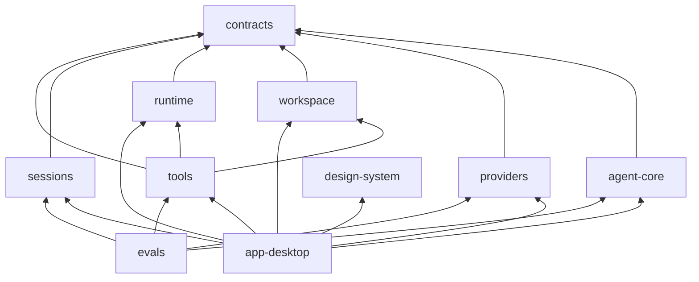

# Chiller — подробная спецификация модулей

Дата: 16 октября 2026. Статус: план реализации после согласования основного направления.

## 1. Структура и направления зависимостей

Уточнение исходного плана: выделяем `:contracts` и `:tools`, чтобы независимо разрабатывать реализацию хранения, файлов, сети и UI. Получается десять Gradle-модулей; дополнительные модули создавать только при реальной необходимости.

```text
contracts/       :contracts       общие типы и порты
agent-core/      :agent-core      координация, контекст, policy
providers/       :providers       HTTP/SSE, профили моделей
workspace/       :workspace       файлы, поиск, snapshots, checkpoints
runtime/         :runtime         процессы и платформенные адаптеры
tools/           :tools           schemas и типизированные tools
sessions/        :sessions        JSONL, blobs, recovery, export
design-system/   :design-system   визуальные примитивы Compose
app-desktop/     :app-desktop     экраны, ViewModels, composition root
evals/           :evals           fixtures, сценарии, headless runner
```

Все source sets на первом этапе JVM: `src/main/kotlin`, `src/test/kotlin`, package `dev.chiller.<area>`. Common/KMP source sets не добавлять без второго Kotlin target. Gradle settings, version catalog и wrapper фиксирует координатор в bootstrap.



`design-system` знает только UI-типы собственного уровня, Compose и иконки. `contracts` знает Kotlin, coroutines и serialization. `agent-core` зависит только от contracts и этих базовых библиотек; реализации приходят через constructor injection. `workspace` и `runtime` используют ArtifactStore/EventSink через contracts, а не импортируют sessions. Evals может подключать реализации headless; UI tests располагаются в app-desktop.

## 2. :contracts — общий язык системы

**Ответственность:** IDs, события, запросы, результаты, ошибки, интерфейсы внешних эффектов. Это не склад utility-кода.

Планируемые пакеты и файлы:

| Пакет | Содержимое |
|---|---|
| `ids` | SessionId, RunId, TurnId, ToolCallId, OperationId, WorkspaceId, SnapshotId, ArtifactId, ProcessId |
| `model` | AgentMessage, ContentPart, ToolCall, ToolDefinition, ModelRequest, ModelEvent, Usage, ProviderCapabilities |
| `agent` | RunCommand, RunState, AgentEvent, ExecutionMode, RunBudget, PolicyDecision |
| `tools` | ToolSpec, ToolOutcome, ToolError, ToolEffect, ToolContext, ToolExecutor |
| `workspace` | WorkspacePath, FileSnapshot, ObservedRange, FileEdit, ChangeSet, CheckpointRef |
| `ports` | LlmProvider, EventStore, ArtifactStore, WorkspaceService, ProcessService, InteractionBroker, CredentialStore, Clock |

Все межмодульные результаты типизированы. Nullable-значения допустимы только с ясной семантикой; неизвестный usage не равен нулю. Provider extensions — opaque JSON в отдельном provider-owned поле, а не общая Map для всего приложения. Не вводить глобальные singleton registries.

**Готовность:** contract fixtures сериализуются и восстанавливаются; один пример полного tool round-trip; различимы known failure и unknown outcome; доменные типы не импортируют Compose/Ktor/NIO реализации. Подробности — CONTRACTS.md.

## 3. :providers — сеть и модельные протоколы

**Ответственность:** преобразовать ModelRequest в конкретный wire format, разобрать ответ в ModelEvent. Не исполняет инструменты, не сокращает историю самостоятельно, не показывает окна.

Состав:

- `transport/KtorTransport`: HTTP client lifecycle, TLS, headers, status/error parsing, timeouts.
- `chat/ChatCompletionsCodec`: request/response DTO, multipart content, assistant/tool pairing.
- `stream/SseDecoder`: byte/UTF-8 boundary handling, SSE frames, comments, `[DONE]`.
- `stream/ToolCallAssembler`: накопление arguments по index/ID, complete/aborted semantics.
- `profiles/DeepSeekProfile`: `deepseek-flash`, thinking settings, protocol replay payload.
- `profiles/VllmGemmaProfile`: base URL/model editable, capabilities unknown до проверки сервера.
- `profiles/GenericProfile`: минимальный совместимый контракт; extras opt-in.
- `probe/CapabilityProbe`: короткая диагностика; read-only endpoint inspection отдельно от платного generation probe.
- `errors/ProviderErrorMapper`: Unauthorized, RateLimited, ContextExceeded, TransportInterrupted, InvalidResponse, UnsupportedFeature.

**Первая поставка:** FakeProvider + DeepSeek codec/stream fixtures + подключаемый real transport. Gemma — конфигурируемый профиль и контрактные тесты; live readiness остаётся pending.

**Проверки:** фрагменты JSON/Unicode, несколько calls, missing ID, arguments continuation, 401/429/5xx, EOF до завершения, финальный usage, отмена. Секрет не попадает в exception strings. Thinking/tool history проходит отдельный replay fixture.

**Не входит в первую ночь:** Responses API, автоматический failover между провайдерами, OAuth, скачивание/запуск модели, автоматическая загрузка production conversations для анализа.

## 4. :workspace — точные файловые операции

**Ответственность:** доступ к разрешённой рабочей папке, snapshots, чтение/поиск, изменение файлов и локальное восстановление.

Компоненты:

- `WorkspaceResolver`: root identity, relative paths, canonical parents, symlink/hardlink policy, case behavior.
- `FileReader`: bounded reads, UTF-8/BOM, line index, EOL metadata; бинарный input отклоняется.
- `SnapshotStore`: короткий ID, byte hash, read ranges, session/workspace binding, invalidation/expiry.
- `SearchService`: ripgrep argv, JSON results, limits/cursors, ignore handling. Если бинарника нет — явный диагностический результат, без silent unsafe shell fallback.
- `EditPlanner`: immutable edits → candidate bytes + diff, без записи.
- `WorkspaceWriter`: сериализация записей, prepare, temp write, recheck, atomic replace на поддерживаемой FS.
- `CheckpointService`: before image, before/after fingerprints, конфликтующий undo.
- `FileMutationService`: create/move/delete с теми же правилами policy/journal/recovery.
- `ChangeTracker`: изменения Chiller отдельно от исходных пользовательских правок.

Поток: `read → plan → validate → approve if required → prepare → write → verify → commit`. Состояние changed-after-read возвращается явно; наблюдение filesystem watcher используется только для UX/invalidation hint.

**Проверки:** пустой файл, LF/CRLF, UTF-8/BOM, multiline, EOF newline, emoji/кириллица, повторяющийся код, overlapping edits, outside-root, symlinks, disk-full simulation, внешний writer, recovery. Полная матрица — CHILLER_PLAN.md.

**MVP ограничения:** обычные UTF-8-файлы, bounded size, single-file атомарность по возможностям FS. Нет recursive delete, silent encoding conversion, автоматического fuzzy-merge и гарантированной транзакции сразу по нескольким файлам.

## 5. :runtime — процессы и платформенные операции

**Ответственность:** ProcessService, CredentialStore и позднее screenshot/PTY adapters. Не принимает решения, разрешена ли команда: это Policy; runtime повторно проверяет обязательные execution constraints.

Компоненты первой версии: ProcessSupervisor, ProcessRecord, OutputPump, ProcessLogStore, CancellationController, platform termination adapters. `argv` — список, `cwd` — проверенный путь, environment — allowlist добавок, не произвольное содержимое среды в логах.

stdout/stderr drain одновременно. Exit наблюдается независимо от EOF: потомок может держать pipe открытым. После завершения direct child действует bounded drain deadline; tail получает truncated/incomplete flag. Background service живёт по явно выбранному lifecycle и отображается отдельно от model run.

Мягкое/жёсткое завершение, deadlines и output caps конфигурируются. Cancel не ждёт бесконечно. При отсутствии надёжной поддержки tree termination на ОС показывать ограничение; не обещать sandbox. PID не равен устойчивому process identity после перезапуска.

**Проверки:** два больших потока, отсутствие newline, timeout, spawned descendants, stdout pipe held open, повторный stop, неверный cwd/executable, cancel при запуске, превышение лимита.

**По этапам:** первая ночь — non-interactive commands на текущей ОС и memory/env credentials; alpha — native secret storage и выбранная стратегия process groups; beta — platform matrix, screenshot adapters, PTY spike, isolation strategy.

## 6. :tools — интерфейс модели к среде

**Ответственность:** 12 tools из исходного плана, schemas, typed decoding/domain validation, единый error mapping. Не содержит сетевого клиентского кода или самостоятельного agent loop.

ToolSpec объявляет name, description, schemaVersion, JSON schema и эффект. ToolRegistry фильтрует доступные tools по режиму/профилю. ToolExecutor регистрирует prepare/result, вызывает реализации и ограничивает output; повторный operation ID не запускается снова без проверки ledger.

Три семейства:

1. File tools: list_files, search_text, read_file, edit_file, create_file, move_file, delete_file.
2. Process tools: run_process, read_process, stop_process.
3. Interaction/output: read_artifact, ask_user.

Ошибки декодирования дают короткую схему восстановления. Общий JSON Schema fixture + Kotlin DTO проверяются одними examples. Нельзя исправлять невалидный аргумент так, что меняется намерение: например, превращать относительный путь с выходом из root в другой существующий файл.

**Проверки:** schema/examples parity, missing/unknown fields, all effects denied in Plan, bounded output, duplicate operation, cancellation, error mapping. Fake WorkspaceService/ProcessService позволяет собирать tools до готовности runtime.

## 7. :sessions — журнал и восстановление

**Ответственность:** ordered durable events, blobs, projections, restart recovery и экспорт. Не выбирает модель и не выполняет неизвестные pending operations при replay.

Компоненты: JsonlEventStore, SingleWriter, EventCodecV1, BlobArtifactStore, SessionIndex, SessionProjection, RecoveryScanner, ExportService, RetentionService. EventStore и ArtifactStore реализуют contracts ports.

Дельты батчатся; prepared/committed/results — границы durable write. Технический журнал без ключей отделён от private replay data. Derived index можно перестроить. Payload type-specific; schema_version независим от версии приложения. Подготовить один migration fixture для future schema change, не писать универсальную систему миграций заранее.

**Recovery:** оборванная последняя строка → восстановление до последнего валидного события; interior corruption → явно interrupted/corrupt; pending file write → reconcile fingerprints; pending external process → unknown, не retry. Не пересоздавать tool result из догадки.

**Проверки:** ordering и concurrency, repeated event IDs, truncated tail, corrupted middle, artifact missing, disk full, prepare-without-commit, resume answered/unanswered question, sanitized export.

**Первая ночь:** append/replay, blobs, restart list, file-operation reconciliation. Rich Markdown export, retention UI и полноценная migration UX могут завершаться следующим этапом.

## 8. :agent-core — рабочий цикл

**Ответственность:** state machine, context construction, policy, budgets, questions/approvals, loop detection и recovery decisions.

Компоненты:

- AgentCoordinator: единственный writer run state.
- RunReducer: deterministic events → RunState; все критические переходы покрываются fixtures.
- ContextPlanner: budget reserve, message pairing, pinned inputs, truncation/compaction requests.
- PolicyEngine: Plan/WorkspaceEdit, workspace grants, process permissions, scope expiration.
- ToolScheduler: последовательные effects, ограниченные независимые reads.
- InteractionBroker adapter: pending question IDs, one-answer semantics, cancellation/stale answer.
- RunBudgetTracker: rounds/time/tokens/cost known-or-unknown.
- RecoveryCoordinator: load projection, mark interrupted, reconcile, explicit resume.

Tool results не теряются при slow UI. Failed tool — валидный результат для модели; transport error — отдельное событие. Coroutine cancellation не ловится как обычная recoverable exception. Model streaming может содержать content и reasoning одновременно; никакого требования обязательно пройти фазу Thinking.

**Готовность:** headless scenario на FakeProvider: search/read/edit/run test/final; отказ в Plan; stop during stream/process; unanswered question restore; repeated error limit; no re-execution after unknown outcome.

## 9. :design-system — визуальный язык

**Ответственность:** ChillerTheme, color/type/space/motion tokens, компоненты и их состояния. Доменные события преобразуются в display props вне этого модуля.

Компоненты: ChillerButton/IconButton, TextField, ComposerFrame, SidebarRow, StatusLabel, ToolActivityRow, ExpandableSection, CodeBlock, DiffRow, InspectorTabs, EmptyState, InlineError, AttachmentChip, FocusRing. UI демонстрации с synthetic props.

Светлая/тёмная темы, reduced motion, disabled/focus/pressed, scalable text. Нет отдельной мобильной дизайн-системы и стороннего web-renderer для обычного чата.

**Готовность:** gallery screen, keyboard navigation, читаемость длинных путей, темы и zoom; динамическая карточка не вызывает scroll jump. Детали — DESIGN.md.

## 10. :app-desktop — приложение

**Ответственность:** composition root, navigation, window lifecycle, ViewModels, проектирование пользовательских действий в RunCommand.

Features: onboarding/workspace picker; sessions; chat; changes; context inspector; provider settings; approval/question surfaces. AppDependencies создаёт реальные реализации; preview/fake composition выделен явно. Режим demo визуально маркируется, чтобы не спутать simulated test status с выполненной проверкой.

AppState включает workspace, selected session, layout mode, active run summaries. Focus/Studio используют одну ChatViewModel и одну selection state; переключение не пересоздаёт run, provider или историю. Settings — отдельная модель, ключи в state redacted/opaque, а не String в debug toString.

Keyboard: Cmd/Ctrl+N new chat, Cmd/Ctrl+Enter send, Escape cancel только в согласованном контексте, shortcut открытия inspector; exact bindings фиксируются после проверки конфликтов ОС. Enter/Shift+Enter semantics и IME composition не должны случайно отправлять текст.

**Готовность:** пользователь выбирает workspace, профиль, отправляет задачу, видит инструмент/diff, отменяет работу и открывает сессию после restart. Обе layout views, error/empty/loading/asking/conflict. Нет прямого ProcessBuilder или HTTP в composable.

## 11. :evals — доказательства

Содержит synthetic fixtures providers/files/events, небольшой headless runner, несколько real-code fixture projects и отчёт по scenarios. Удалённый API opt-in; default `check` полностью offline. UI screenshots/acceptance отдельно от agent pass rate.

Минимальный набор: happy path, stale snapshot, duplicate code, malformed tool call, interrupted SSE, cancellation, process output flood, crash recovery, Plan denial, unanswered question, restart replay, DeepSeek thinking history. Затем расширить до 30–50 задач и held-out set.

Отчёт: commit, runtime/provider fingerprints, scenario, expected/actual outcome, checks passed/failed/skipped, durations, usage if reported, artifacts. Не складывать API secrets или пользовательский проект в fixtures.

## 12. Общие определения готовности

Модуль готов к интеграции, когда собирается с реальными contracts, meaningful tests проходят, нет циклических зависимостей, нет unimplemented reachable production code, ошибки/отмена определены, docs соответствуют фактическому поведению. Готовый модуль не равен готовому продукту: обязательна проверка сквозного сценария.

Зафиксировать после bootstrap: версии toolchain, target OS/arch, baseline memory/startup, известные unsupported features. До этого численные показатели производительности являются гипотезами.
